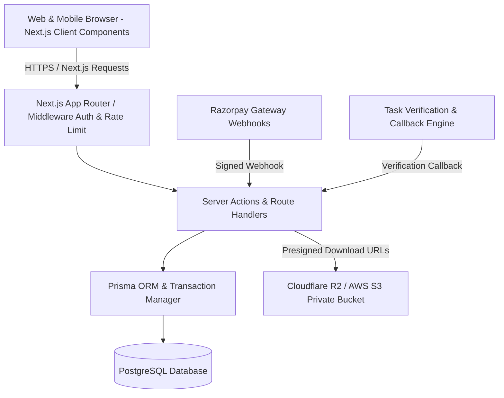

# CPC Marketplace — Project Overview

## 1. Executive Summary

**CPC Marketplace** (Applications, Websites & Digital Products Store) is a modern, high-performance digital commerce platform designed for discovering, purchasing, downloading, and managing source code, web applications, mobile apps, SaaS starter kits, website templates, and digital assets.

The platform centers on a secure, closed-loop internal credit economy powered by **CPC Coins**, complemented by direct fiat deposits and mixed payment capabilities. Users earn coins through admin-curated tasks (such as verified promotional visits and instructional links), deposit funds via India-compliant payment gateways, and redeem coins or fiat for verified digital downloads.

## 2. Design Philosophy

The user interface blends two distinct aesthetic archetypes:
1. **Google Play Store Browsing Paradigm**:
   - High-density card discovery grids with platform chips (Next.js, Flutter, React, Vue, Python, Node).
   - Clear visual indicators for pricing (Free vs CPC Coins vs INR).
   - Ratings badges, install/purchase counters, and responsive visual carousels.
   - Categorized shelves ("Trending Applications", "Top Developer Toolkits", "Editor's Choice").
2. **Google AI Studio Workspace Aesthetics**:
   - Clean, purposeful productivity workspace with restrained accent palettes.
   - High-contrast, clean dark/light mode typography using modern monospace and geometric sans font stacks.
   - Minimalist toolbars, sleek balance indicators, collapsible side panels, and tabular transaction ledgers.
   - Original CPC Marketplace branding without copying third-party trademarks or proprietary layouts.

## 3. Core User Personas

| Persona | Capabilities | Access Controls |
| :--- | :--- | :--- |
| **Guest** | Browse published products, explore categories, search/filter, inspect public previews, view legal docs. | Read-only public endpoints; no coin earning or private file access. |
| **Registered User** | Earn CPC Coins via verified tasks, deposit funds, purchase products, stream/download licensed digital assets, manage wallet ledger, write verified reviews, submit support tickets. | Authenticated session; strictly scoped to own user ID and entitlements. |
| **Publisher (Multi-Vendor ready)** | Submit products, upload versions, define pricing (Free, Coins, Mixed, Fiat), submit changelogs, view product sales analytics. | Authenticated publisher role; requires admin review and approval before publishing. |
| **Moderator** | Review pending product submissions, verify flagged task completions, moderate user reviews. | Scoped moderator permissions without financial ledger tampering privileges. |
| **Super Admin** | Full governance over products, task budgets & cooldowns, user balances & bans, deposit approvals, audit logs, and system settings. | High-security administrative RBAC enforced strictly on the server. |

## 4. Architectural Evaluation: Legacy vs Modern Target

During **Stage 0 (Repository Discovery)**, we audited the existing repository commit history (`codemarket-server` with Express + MongoDB + Mongoose):

| Aspect | Legacy Codebase (`server/`) | Target Production Architecture | Rationale for Architecture Choice |
| :--- | :--- | :--- | :--- |
| **Framework** | Express 4.18 (JavaScript ES Modules) | **Next.js App Router (React 19 / TypeScript)** | Unified full-stack app with React Server Components, server actions, client components, and zero CORS friction. |
| **Type Safety** | Plain JS without compilation checks | **Strict TypeScript (strict: true)** | Mission-critical financial ledger and purchase entitlements require compile-time type verification. |
| **Database** | MongoDB / Mongoose (Document Store) | **PostgreSQL + Prisma ORM** | Financial ledgers require ACID transactions, strict schema constraints, foreign key cascades, and unique idempotency indices. |
| **Accounting** | In-place counter mutations (`$inc`) | **Immutable Double-Entry Ledger** | Strict auditing: every coin delta has a ledger record with immutable audit trail. |
| **Storage** | Multer S3 | **S3-Compatible Object Storage (AWS S3 / Cloudflare R2)** | Signed, time-limited presigned URLs (max 15 mins) for authorized file downloads. |
| **Payments** | Razorpay / Stripe basic JS calls | **Razorpay / Cashfree Adapter with Webhook Cryptographic Signatures** | Idempotent webhook verification to eliminate double credits or replay attacks. |

## 5. High-Level System Architecture

## 6. Key Deliverables Roadmap

1. **Stage 1**: Product & UI Foundation (Design system, Google Play & AI Studio shell, layouts, mock-free interactive navigation).
2. **Stage 2**: Database & Authentication (PostgreSQL schema, Prisma migrations, secure sessions, RBAC).
3. **Stage 3**: Product Catalog (Search, filters, categories, product details, admin approval).
4. **Stage 4**: CPC Coin Ledger & Wallet (Immutable financial ledger, atomic balance updates, concurrency safeguards).
5. **Stage 5**: Purchase & Download Engine (Atomic purchase transactions, entitlements, short-lived presigned URLs).
6. **Stage 6**: Deposits & Payment Gateway (Razorpay sandbox integration, signed webhooks, idempotency).
7. **Stage 7**: Tasks & Rewards Engine (Limits, server-side cooldowns, reward budgets, anti-fraud tracking).
8. **Stage 8**: Short-Link & Task Verification (Provider adapters, callback verification, replay protection).
9. **Stage 9**: Admin Control Center (Real-time analytics, user moderation, coin adjustments with audit records).
10. **Stage 10**: Documentation, Reviews & Support (PDF docs, verified purchase reviews, support tickets).
11. **Stage 11**: Integration Testing & Quality Gates (End-to-end testing, security audits, load/concurrency tests).
12. **Stage 12**: Production Deployment & Operational Runbook.
